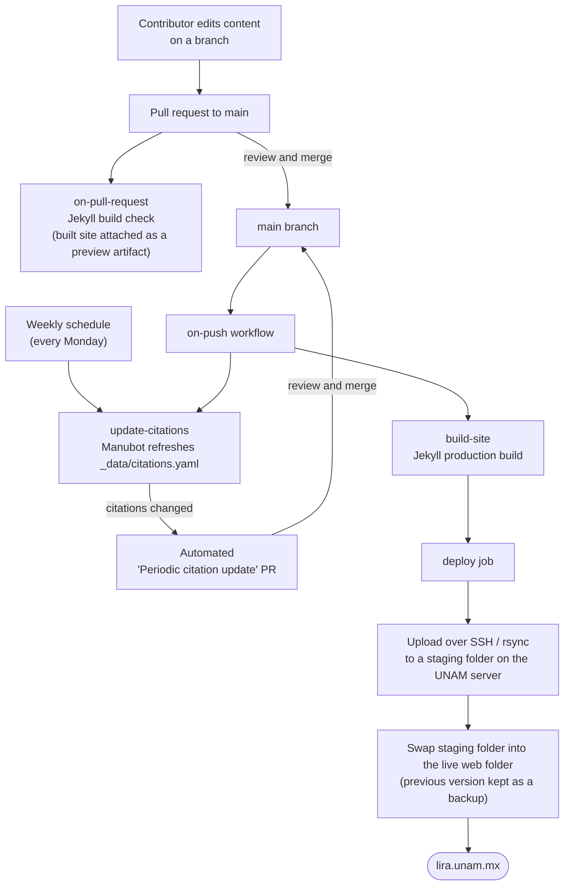

# LIRA website: lira.unam.mx

[](https://github.com/LIRA-UNAM/website_v1/actions/workflows/on-push.yaml)
[](https://github.com/LIRA-UNAM/website_v1/commits/main)
[](https://github.com/LIRA-UNAM/website_v1/graphs/commit-activity)
[](https://github.com/LIRA-UNAM/website_v1/pulls)
[](LICENSE.md)

This repository holds the source of **[lira.unam.mx](https://lira.unam.mx)**, the LIRA website at UNAM.

The site is built with [Jekyll](https://jekyllrb.com/) on top of the
[Lab Website Template](https://github.com/greenelab/lab-website-template) by the Greene Lab.
Publication citations are generated automatically from simple identifiers (DOI, ORCID, PubMed, …)
with [Manubot](https://manubot.org/). For anything about the template's components and configuration,
see the [template documentation](https://greene-lab.gitbook.io/lab-website-template-docs).

## How the website is updated automatically

Nobody uploads files to the server by hand. GitHub Actions builds and deploys the site every time
`main` changes.



1. **Pull requests.** Every pull request to `main` triggers a Jekyll build. A broken change shows up
   here before it reaches the live site, and the built site can be downloaded from the workflow run
   to preview it.
2. **Merge to `main`.** The `on-push` workflow runs two jobs:
   - `update-citations` checks whether the publication list needs refreshing. If it does, it opens a
     pull request instead of committing to `main` directly.
   - `build-site` builds the site in production mode and passes it to the `deploy` job.
3. **Deploy.** The built site is uploaded to a staging folder on the UNAM server. Only after the
   upload completes is the staging folder swapped in as the live site, and the previous version is
   kept as a backup. A failed transfer never leaves the live site half-updated. Deploys run one at a
   time, and only when deployment is enabled in the repository settings.
4. **Weekly citation refresh.** Every Monday the citations are checked again. Merging the resulting
   pull request redeploys the site through step 2.

## Debugging and testing locally

Test changes on your own machine before opening a pull request. The only requirement is
[Docker](https://docs.docker.com/get-docker/). From the repository root:

```bash
./.docker/run.sh
```

The script:

1. Builds the `lab-website-renderer` image from `.docker/Dockerfile` (Ruby 3.1 + Jekyll, Python +
   Manubot), the same toolchain the GitHub Actions build uses.
2. Starts a container with the repository mounted at `/usr/src/app`, so edits on your machine show up
   inside it immediately.
3. Runs `_cite/cite.py` once to generate `_data/citations.yaml` (this can take a little while the
   first time, since metadata is fetched online), then starts `jekyll serve`.

Open <http://localhost:4000>. While it runs:

- **Pages, styles, includes, layouts:** saved changes rebuild automatically, and the browser reloads
  through LiveReload (port `35729`).
- **`_config.yaml`:** Jekyll restarts by itself.
- **Citation sources** (`_data/sources*`, `_data/orcid*`, `_data/pubmed*`, `_data/google-scholar*`):
  the cite process reruns.

Stop the server with <kbd>Ctrl</kbd>+<kbd>C</kbd>. The container is started with `--rm`, so nothing is
left behind.

### Troubleshooting

- **Build errors.** Jekyll runs with `--trace`, so the full Ruby stack trace is printed in the
  terminal. Liquid and front-matter errors name the file at fault.
- **"container name already in use".** A previous container is still running. Remove it with
  `docker rm -f lab-website-renderer` and run the script again.
- **Port 4000 or 35729 already in use.** Stop the other local Jekyll/server process, or change the
  `--publish` lines in `.docker/run.sh`.
- **"the input device is not a TTY"** (CI, scripts, some IDE terminals). `run.sh` uses
  `--interactive --tty`. Run the same command without those two flags:

  ```bash
  docker run --name lab-website-renderer --init --rm \
    --publish 4000:4000 --publish 35729:35729 \
    --volume "$(pwd):/usr/src/app" \
    lab-website-renderer:latest
  ```

- **Dependencies changed** (`Gemfile`, `Gemfile.lock`, `_cite/requirements.txt`). Rerun `run.sh`, which
  rebuilds the image with the new packages.
- **Check a production build.** Run what CI runs:
  `docker run --rm -v "$(pwd):/usr/src/app" -e JEKYLL_ENV=production lab-website-renderer:latest bundle exec jekyll build`,
  then inspect the output in `_site/`.

Without Docker, a local Ruby 3.1 setup also works: `bundle install && bundle exec jekyll serve`
(citations are not regenerated this way).

## Editing the site

| What                  | Where                       |
| --------------------- | --------------------------- |
| Team members          | `_members/`                 |
| News / highlights     | `_news/`                    |
| Blog posts            | `_posts/`                   |
| Projects              | `projects/`, `_data/`       |
| Publication sources   | `_data/` (inputs to `_cite/`) |
| Images                | `images/`                   |
| Site-wide settings    | `_config.yaml`              |

Workflow: create a branch, make your changes, open a pull request to `main`, and merge it once the
build check passes. The site goes live a few minutes after the merge.

## Credits

Based on the [Lab Website Template](https://github.com/greenelab/lab-website-template) by the
[Greene Lab](https://greenelab.com/). See [LICENSE.md](LICENSE.md).
