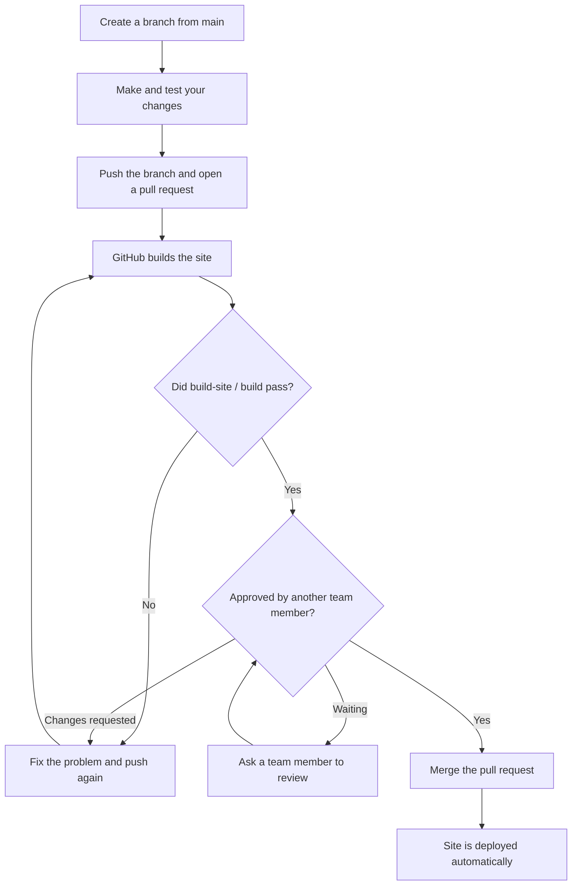
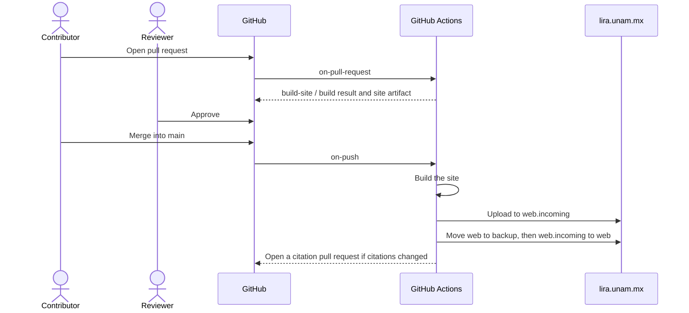

# Laboratorio de Investigación en Robótica Avanzada (LIRA)

Source code for the website of LIRA, Universidad Nacional Autónoma de México.

**Live site: <https://lira.unam.mx>**

[](https://github.com/LIRA-UNAM/website_v1/actions/workflows/on-push.yaml)

This website is built with [Jekyll](https://jekyllrb.com/) and is based on the [Lab Website Template](https://github.com/greenelab/lab-website-template) by the Greene Lab. For anything not covered here, such as page components and styling, see the [template documentation](https://greene-lab.gitbook.io/lab-website-template-docs).

## Contents

- [Run the site locally](#run-the-site-locally)
- [Add a new publication article](#add-a-new-publication-article)
- [Add a new blog post](#add-a-new-blog-post)
- [Add a new team member](#add-a-new-team-member)
- [Content you can use in posts and member pages](#content-you-can-use-in-posts-and-member-pages)
- [How to contribute changes](#how-to-contribute-changes)
- [How the automation works](#how-the-automation-works)

## Run the site locally

You need [Docker](https://www.docker.com/) and a clone of this repository. From the repository root, run:

```bash
./.docker/run.sh
```

Then open <http://localhost:4000>. The site rebuilds when you save a file, and citations are regenerated when `_data/sources.yaml` changes.

## Add a new publication article

> [!WARNING]
> Do not modify `_data/citations.yaml` yourself. It is generated automatically, and manual changes will be overwritten. To add or change a publication, modify `_data/sources.yaml`.

Publications are listed by hand in `_data/sources.yaml`, and the site reads the generated results from `_data/citations.yaml`.

1. Optional: add a thumbnail to `images/publications/`.
2. Add an entry to `_data/sources.yaml`:

   ```yaml
   - id: doi:10.1234/example.5678
     type: paper
     image: images/publications/example.png
   ```

   The title, authors, publisher and date are looked up from the `id`. Any field you write yourself, such as `title`, `authors`, `date` or `description`, replaces the value that was looked up.

3. Run the site locally. This updates `_data/citations.yaml`.
4. Check the entry on the Publications page.
5. Open a pull request that includes **both** `_data/sources.yaml` and `_data/citations.yaml`.

If you can't run the site locally, open the pull request with `_data/sources.yaml` only. After it merges, a bot opens a second pull request with the updated citations, and the publication appears once that one is approved and merged too.

## Add a new blog post

Blog posts appear on the [Blog page](https://lira.unam.mx/media/).

1. Add images to a new folder, such as `images/blog/my-event/`.
2. Create a file in `_posts/` named `YYYY-MM-DD-short-title.md`. The date in the file name is the publication date.
3. Add the post details and content:

   ```markdown
   ---
   title: 1st place at Example Cup 2026
   image: images/blog/my-event/cover.jpg
   author: miguel-garcia
   tags: robotics, competition
   ---

   Write the post here using Markdown.

   
   ```

   `author` is the file name of the author's page in `_members/`, without `.md`.

4. Check the post locally and [open a pull request](#how-to-contribute-changes).

### All supported post fields

These go between the `---` lines at the top of the file. All of them are optional, but every post should have `title`, `image` and `author`.

| Field | Format | What it does |
| --- | --- | --- |
| `title` | Text | Post heading and its title on the Blog page |
| `image` | File path | Thumbnail on the Blog page. It isn't shown on the post itself, so add it to the content if you want it there |
| `author` | Text or list | One or more authors. A value matching a file in `_members/` shows that member's portrait; anything else is shown as plain text |
| `tags` | Text or list | Tags shown on the post, which link to a Blog page search. Use a list, such as `[robot soccer, mexico]`, for tags with spaces |
| `date` | `YYYY-MM-DD` | Replaces the date from the file name |
| `last_modified_at` | `YYYY-MM-DD` | Replaces the "last updated" date, which otherwise comes from git |
| `description` | Text | Summary for search engines and link previews |
| `excerpt` | Text | Summary on the Blog page. Otherwise it uses the first paragraph, or the text between `<!-- excerpt start -->` and `<!-- excerpt end -->` in the post |

The [fields for all pages](#fields-for-all-pages) also work on posts.

## Add a new team member

Each person has one file in `_members/`, which creates their profile page and their card on the [People page](https://lira.unam.mx/people/).

1. Add a photo to `images/members/`.
2. Create `_members/first-last.md`:

   ```markdown
   ---
   name: First Last
   image: images/members/first.jpg
   role: graduate
   affiliation: Facultad de Ingeniería UNAM
   links:
     github: their-github-username
   ---

   A short biography, written in Markdown.
   ```

3. Set `role` to one of these values. Other roles exist in `_data/types.yaml`, but the People page only lists these four:

   | `role` | Where it appears on the People page |
   | --- | --- |
   | `professor` | Professors section at the top |
   | `graduate` | Masters Students tab |
   | `undergrad` | Undergraduate Students tab |
   | `external` | Past Alumni tab |

4. Check the page locally and [open a pull request](#how-to-contribute-changes).

When someone leaves the lab, change their `role` to `external` rather than deleting the file.

### All supported member fields

These go between the `---` lines at the top of the file. The text below them is the biography, shown only on the member's own page.

| Field | Format | What it does |
| --- | --- | --- |
| `name` | Text | The member's name. Required |
| `image` | File path | Portrait photo. A placeholder is shown if it's missing |
| `role` | One of the [roles above](#add-a-new-team-member) | Sets the People page section, badge icon and role label |
| `affiliation` | Text | Shown under the name |
| `description` | Text | Replaces the role label on the card, such as "Masters Student" |
| `links` | Link types and values | Buttons on the member's page. See the table below |
| `aliases` | List | Name variations used by the link to the member's papers on their page. Defaults to `name` |
| `research` | List | Research fields, shown only on `wide` cards |
| `education` | List of `degree`, `institution` and `year` | Education history, shown only on `wide` cards |
| `style` | `small`, `tiny` or `wide` | Changes this member's card. Professors already use `wide` |

For example:

```yaml
research:
  - Mobile Robotics
education:
  - degree: Ph.D. Computer Science
    institution: Universidad Nacional Autónoma de México
    year: 2019
aliases:
  - First Last
  - F. Last
links:
  github: their-github-username
  email: name@example.com
```

Leave out any link that doesn't apply rather than leaving it blank. These link types are available under `links`:

| Link type | Value |
| --- | --- |
| `github`, `twitter`, `bluesky`, `facebook`, `instagram`, `youtube` | Username or handle |
| `linkedin` | Profile name, the part after `linkedin.com/in/` |
| `orcid` | ORCID iD, such as `0000-0001-2345-6789` |
| `google-scholar` | The `user=` value in the profile address |
| `email` | Email address |
| `phone` | Phone number |
| `website`, `home-page`, `link` | Full web address |

The `group` field that appears in some existing member files has no effect on the site. The [fields for all pages](#fields-for-all-pages) also work on member pages.

## Content you can use in posts and member pages

### Fields for all pages

These work at the top of both post and member files:

| Field | Format | What it does |
| --- | --- | --- |
| `header` | File path | Replaces the background image of the page header |
| `footer` | File path | Replaces the background image of the page footer |
| `header-dark` | `true` or `false` | Whether the header uses a dark background style |
| `footer-dark` | `true` or `false` | Whether the footer uses a dark background style |
| `redirect_from` | List | Old addresses that should redirect to this page |
| `permalink` | Address | Replaces the page's automatic address |
| `published` | `false` | Hides the page from the site without deleting the file |

### Text formatting

Below the `---` lines you can use regular Markdown: headings, **bold**, _italics_, links, images, lists, quotes, code blocks and tables. The site also supports [Mermaid](https://mermaid.js.org/) diagrams in `mermaid` code blocks and math between `$$` signs.

### Components

Add these anywhere in the content. Quoted values are text, and a value without quotes refers to a variable created with `capture`.

```liquid
This is **Markdown** content.

```

| Component | Example | Options |
| --- | --- | --- |
| Figure | `` | `image`, `caption`, `link`, `width`, `height` |
| Alert | `` | `type` (`tip`, `help`, `info`, `success`, `warning`, `error`), `content` |
| Button | `` | `type`, `link`, `text`, `icon`, `tooltip`, `style` (`bare`), `flip` |
| Icon | `` | `icon` ([Font Awesome](https://fontawesome.com/icons) name) |
| Float (text beside an element) | `` | `content`, `flip`. End it with `` |
| Grid | `` | `content`, `style` (`square`) |
| Card | `` | `image`, `title`, `subtitle`, `description`, `link`, `tooltip`, `tags`, `repo`, `style` (`small`) |
| Feature | `` | `image`, `title`, `text`, `link`, `flip` |
| Section | `` | `background`, `dark`, `size` |
| Member portrait | `` | `lookup` (file name in `_members/`), `style` |

See the [template documentation](https://greene-lab.gitbook.io/lab-website-template-docs) for more detail on each component.

## How to contribute changes

The `main` branch is protected, and every change, including those from administrators, goes through a pull request. **Anything merged to `main` is published to the live site automatically.**

A pull request can be merged only when:

- at least **one team member other than the author** has approved it, and
- the **`build-site / build`** job has passed.



### Step by step

1. Update your local copy and create a branch:

   ```bash
   git switch main
   git pull
   git switch -c add-example-cup-post
   ```

2. Make your changes and check them with `./.docker/run.sh`.
3. Commit and push:

   ```bash
   git add _posts/2026-11-20-example-cup.md images/blog/example-cup
   git commit -m "Add Example Cup 2026 post"
   git push -u origin add-example-cup-post
   ```

4. [Open a pull request](https://github.com/LIRA-UNAM/website_v1/pulls) into `main` and ask a team member to review it.
5. Wait for the build to pass and for the approval.
6. Select **Merge pull request**. The site updates within a few minutes.

Good to know:

- You can't approve your own pull request.
- Pushing new commits cancels earlier approvals, so the reviewer has to approve again.
- To see the built site before merging, open the pull request's **Checks** tab, go to the run's summary and download the `site` artifact.
- If you don't have write access to this repository, open the pull request from a fork.

### For reviewers

Before approving, check that the content is correct, the images load, and no private information has been added. Download the `site` artifact if you want to see the result.

## How the automation works



| Workflow | Runs when | What it does |
| --- | --- | --- |
| `on-pull-request` | A pull request into `main` is opened or updated | Builds the site with read-only access and attaches it as an artifact |
| `on-push` | Changes land on `main` | Builds and deploys the site, and opens a pull request if citations changed |
| `on-schedule` | Weekly, on Mondays | Refreshes citations and opens a pull request if anything changed |
| `build-site` | Called by the workflows above | Contains the build and deploy jobs |
| `update-citations` | Called by the workflows above | Regenerates `_data/citations.yaml` and opens the pull request |

**Automated citation pull requests** are reviewed like any other, but their build doesn't start by itself. Close and reopen the pull request to start it.

**If a bad change goes live**, use **Revert** on the merged pull request and merge the revert after it is approved. The previous version of the site is also kept on the server in `~/backup`, for emergencies. To restore it, log in and run:

```bash
mv ~/web ~/web.bad && mv ~/backup ~/web
```

**If a deploy fails**, the live site is left as it was. See the [on-push runs](https://github.com/LIRA-UNAM/website_v1/actions/workflows/on-push.yaml) for the error.

## License and credits

Based on the [Lab Website Template](https://github.com/greenelab/lab-website-template) by the Greene Lab, distributed under the BSD 3-Clause License. See [LICENSE.md](LICENSE.md).
